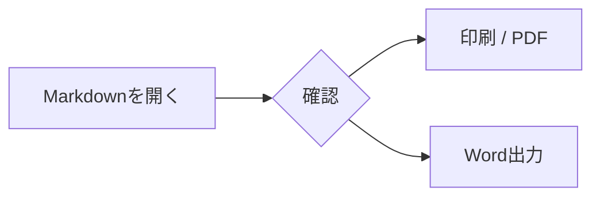

# Markdown Print Viewer

[English README](README_EN.md)

Markdownファイルを「文書」として表示し、そのままブラウザの印刷機能で印刷したり、Microsoft Wordで編集可能な `.docx` に変換したりするための軽量ブラウザアプリです。Markdown自体の編集機能は持ちません。

**Version 1.7.0**

## 特徴

- Markdownファイルをドラッグ＆ドロップして即時表示
- CommonMark / GFMをベースに、テーブル、タスクリスト、脚注、HTML混在をサポート
- Markdown内のHTMLはDOMPurifyでサニタイズ
- `mermaid` コードブロックを図として表示（印刷・PDF・Word出力対応）
- ブラウザ標準の印刷ダイアログを使用（プリンタ／PDF保存）
- A4向けの印刷CSS（画面はダークテーマ、印刷ページと余白は白背景）
- **Word出力**ボタンから、現在のMarkdownをブラウザ内だけで `.docx` に変換
- DOCXでは見出し、段落、リスト、表などをWordネイティブの文書構造として生成
- 日本語／英語UI
- 上部ツールバーをタイトル行だけに折りたたみ可能（スマートフォンで文書表示領域を拡大）
- ダークテーマ専用
- 本文フォント、サイズ、太さ、行間を変更可能
- オプションの「日本語互換性」で、日本語文書におけるMarkdown delimiter解釈の互換補正を適用
- 設定はブラウザのlocalStorageに保存
- 相対パス画像は、必要に応じて「フォルダを開く」で解決
- 通常のブラウザ利用ではインストール不要
- GitHub Pages版はPWAとしてインストール可能。インストール可能な環境では初期画面に **「アプリとしてインストール」** ボタンを自動表示
- Windowsで `.md` の関連付け／ダブルクリック起動に対応（Chrome / Edge）

## 使い方

### 通常版

リポジトリ直下の `index.html` をChromeまたはEdgeで開きます。

1. `.md` ファイルを画面へドラッグ＆ドロップするか、「Markdownを開く」から選択します。
2. 必要に応じてフォント、サイズ、太さ、行間を調整します。
3. 相対パスで指定されたローカル画像がある場合は「フォルダを開く」でMarkdown文書のルートとなるフォルダを選択します。
4. 印刷する場合は「印刷」を押します。
5. Wordで編集する場合は「Word出力」を押します。元のMarkdownファイル名を引き継いだ `.docx` が生成されます。

通常版は起動時に固定バージョンのJavaScriptライブラリをjsDelivrから読み込みます。ブラウザにキャッシュされる場合がありますが、ネットワークなしでの動作を保証するものではありません。

### 完全オフライン版

`offline/index.html` は、必要なJavaScriptライブラリをHTML内へ埋め込んだ単一ファイル版です。

配布済みの `markdown-print-viewer-v1.7.0-offline.zip` を展開すると、生成済みの `index.html` をそのまま開けます。利用者によるビルドは不要です。

開発者が再ビルドする場合は、ネット接続中にWindowsで `BUILD_RELEASE.cmd` を実行してください。固定した依存ファイルを取得してSHA-256を検証し、同梱済みのライセンス原文・ソース入手先を埋め込んだ `offline/index.html` を生成します。さらに `dist/` に通常版・完全オフライン版のZIPと `SHA256SUMS.txt` を作成します。通常版ZIPにもテンプレートとビルド用ファイルを収録しています。

生成後の `offline/index.html` は、外部JavaScriptを参照せず、ネット接続なしで表示・印刷・Word出力ができます。生成済みファイルをGitHubにコミットして構いません。

## インストール・アンインストール

通常のブラウザ利用ではインストール不要です。GitHub Pages版をPWAとしてインストールすると、Windowsでは独立したアプリとして起動でき、`.md` ファイルの関連付け／ダブルクリック起動を利用できます。Androidではホーム画面／アプリ一覧から起動できるWebアプリとして利用できます。

詳しい手順は **[INSTALL_GUIDE.md](INSTALL_GUIDE.md)** を参照してください。WindowsのEdge / Chrome、Android版Chromeについて、インストール、`.md` 関連付け、アンインストール、アプリデータ削除、更新時の注意を個別に説明しています。

### Windowsでの最短手順

1. GitHub Pages版をChromeまたはEdgeで開きます。初期画面に **「アプリとしてインストール」** ボタンが表示されている場合は、それを押してブラウザ標準のインストール画面を進めます。表示されない場合はブラウザメニューからインストールします。
2. エクスプローラーで `.md` を右クリックし、**プログラムから開く** → **Markdown Print Viewer** を選択します。必要なら常に使う設定にします。
3. 以後、`.md` をダブルクリックするとインストール済みPWAが起動し、そのMarkdownが自動表示されます。

アンインストールは、Edgeでは `edge://apps`、Chromeではアプリメニューまたは `chrome://apps` から行えます。Androidでは **設定 → アプリ → Markdown Print Viewer → アンインストール** から削除できます。

マニフェスト更新後などにWindowsの「プログラムから開く」にMarkdown Print Viewerが現れない場合は、一度アンインストールして再インストールするとOS側のファイルハンドラー登録が更新されることがあります。

PWAはFile Handling API / `launchQueue` でWindowsから渡されたローカルファイルを読み取ります。Markdown本文を本アプリのサーバーへアップロードする処理はありません。Service Workerはアプリ本体と固定バージョンの依存ライブラリをキャッシュするため、一度正常に読み込んだ後はオフライン起動にも対応します。

## Word (.docx) 出力

Word出力はPandocやMicrosoft Word本体を呼び出さず、`docx.js` を使ってブラウザ内で直接OOXMLの `.docx` を生成します。変換対象のMarkdownや画像を変換サービスへ送信する処理はありません。

主な変換対応は次のとおりです。

- `#` ～ `######` → Wordの見出し1～6
- 通常段落 → Word段落
- 太字、斜体、取り消し線
- 箇条書き、番号付きリスト、ネスト
- 引用
- インラインコード、コードブロック
- 外部ハイパーリンク
- 水平線
- テーブル → Wordのネイティブ表
- タスクリスト → `☒` / `☐` を含むリスト
- 画像 → 可能な場合はDOCX内へPNGとして埋め込み

現在選択している本文フォントとサイズはWord出力にも反映します。Wordの文字ウェイトはCSSと同じ連続値ではないため、画面上の `Medium (500)` などと完全一致しない場合があります。

### Word変換上の制約

MarkdownからWordへの一方向変換を目的としており、DOCXから元のMarkdownへ戻すことは想定していません。

脚注はWordのネイティブ脚注オブジェクトには変換せず、画面上でレンダリングされた脚注番号と末尾の脚注一覧として出力します。Markdown内の任意HTML、`details`、独自拡張などは、Wordで表現できる範囲に平坦化される場合があります。MermaidはPNG画像として埋め込みます（Wordの編集可能な図形には変換しません）。独自数式記法を専用オブジェクトへ変換する処理はありません。

## Mermaidの図

コードブロックの言語に `mermaid` を指定すると自動で図を描画します。

````markdown

````

[examples/mermaid.md](examples/mermaid.md) にフローチャート、シーケンス図、状態遷移図、円グラフ、クラス図、ER図のサンプルがあります。

- 白い文書面に合わせた明るい配色でSVG画像を表示し、印刷・PDFにも反映します。大きな図は用紙内に縮小されます。
- WordにはPNG画像として埋め込みます。本文のフォント設定は図には適用せず、日本語対応のシステムフォントを使用します。
- 描画中は印刷・Word出力ボタンを一時的に無効にします。構文エラーやライブラリの読み込み失敗では元のコードとメッセージを残し、他の図・本文は表示します。
- 通常版は最初の図の描画時にMermaid 12.3.0をjsDelivrから取得します。PWAではService Workerも事前キャッシュを試みます。完全オフライン版には同じライブラリを埋め込みます。
- 厳格なセキュリティ設定とSVGの画像化を使用します。図内のクリック動作、HTMLラベル、外部画像、外部アイコンパックは対象外です。追加ライブラリを必要とする図式や数式も保証対象外です。
- 図側のテーマ・HTML・セキュリティ設定はビューアーの設定を優先します。1図あたり最大50,000文字・500エッジを上限とし、元のMarkdownファイルは変更しません。

## ローカル画像

Markdownだけをドロップした場合、ブラウザのセキュリティ制約により、同じフォルダにある別ファイルを自動では読み取れません。たとえば次の画像参照を解決する場合です。

```markdown

```

「フォルダを開く」で対象フォルダを追加選択すると、アプリが選択されたフォルダ以下のファイルをブラウザ内で参照し、必要な画像をBlob URLとして表示します。Word出力時も、この解決済み画像をDOCX内部へ埋め込みます。

Chrome / Edgeではフォルダ選択時に「複数のファイルをこのサイトにアップロードしますか？」という趣旨の確認が表示されることがあります。これは `<input webkitdirectory>` に対するブラウザ標準の文言です。本アプリには、選択されたMarkdownやローカル画像を外部へ送信する処理はありません。

Markdownに `https://...` の画像URLが書かれている場合、表示にはネットワーク接続が必要です。Word出力へ画像を埋め込むには、その画像サーバーがブラウザからのデータ取得を許可している必要があります。埋め込めない画像は代替テキストとしてDOCXに残します。

## 通信について

通常版が行う外部通信は、Markdownレンダリング、Mermaid描画、サニタイズ、Word生成用JavaScriptライブラリをjsDelivrから取得するためのものです。本アプリのコードには、ユーザーが選択したMarkdown、画像、フォルダ内ファイルをサーバーへ送信する処理はありません。

完全オフライン版では、Markdown自身が外部URLを参照しない限り、アプリ本体の動作にネットワーク接続は不要です。

## 対応Markdown

レンダリングエンジンは `markdown-it` を使用しています。

- 見出し
- 段落
- 強調、太字、取り消し線
- 箇条書き、番号付きリスト
- 引用
- インラインコード、コードブロック
- リンク、自動リンク
- 画像
- テーブル
- タスクリスト
- 脚注
- HTML混在（サニタイズ後に表示）

Markdownには紙面レイアウト自体の標準仕様はないため、フォント、余白、行間、見出し間隔などはMarkdown Print Viewer独自の印刷向けスタイルです。


## 日本語互換性

ツールバーの「日本語互換性」は、CommonMark / GFMの標準解釈を変更せずに、必要な場合だけ日本語・CJK文書向けの補正を追加するオプションです。初期状態はOFFで、一度変更した設定はブラウザのlocalStorageに保存されます。

現在の版では、太字の末尾が句読点・記号（日本語記号だけでなく `%`、`)`、`!` などを含む）で、その直後に空白なしで日本語が続くケースを補正します。たとえば次の記述です。

```markdown
第二は**因果的な根拠づけ（grounding）**です。
```

英数字主体の強調でも、末尾が記号で、その直後に日本語が続く場合は同じ問題が起こるため補正対象です。

```markdown
- Sofroniewらについては、**171 emotion concepts、blackmail 22%→72%、anti-desperate / calm +0.05で0%**を一次資料で確認しました。
```

また、隣接する強調を含む次のような記述も正しく扱います。

```markdown
**特権（privilege）**と**権威（authority）**
```

補正は表示後の文字列を再解釈するのではなく、markdown-itへ渡す直前の一時的なレンダリング用ソースに対して、意図した閉じdelimiterを認識させる不可視マーカーを挿入する方式です。これにより隣接する `**...**` を誤ってまたいでペアリングすることを避けます。コードブロックやインラインコードは対象外で、元のMarkdownファイル自体は変更しません。Word出力は同じレンダリング結果を基に生成するため、この補正も反映されます。

今後ほかの日本語固有の互換性問題が確認された場合も、この「日本語互換性」処理群へ追加する設計です。

## 行間

ツールバーの「行間」は、本文の行間を3段階で切り替えます。設定はlocalStorageに保存されます。

- **狭い**: 画面 1.34 / 印刷 1.32
- **標準**: 画面 1.48 / 印刷 1.45（v1.4.0までの既定値）
- **広い**: 画面 1.64 / 印刷 1.60

見出しやコードブロックなど、独自の行間を持つ要素はその個別スタイルを維持します。

## フォント

選択可能なプリセットは次のとおりです。

- Standard
- Meiryo
- Yu Gothic
- BIZ UDPGothic
- Yu Mincho
- BIZ UDPMincho

フォントがOSにインストールされていない場合はフォールバックフォントが使用されます。Word出力では、選択したプリセットに応じてWord文書内のASCII／東アジア用フォントを設定します。

## ブラウザ

主にWindows上のGoogle Chrome / Microsoft Edgeを想定しています。フォルダ読み込みには `webkitdirectory` を使用しているため、Chromium系ブラウザを推奨します。

## リポジトリ構成

```text
.
├─ index.html                 通常版（CDNから依存ライブラリを読み込み／PWAエントリ）
├─ manifest.webmanifest       PWAマニフェスト／Markdownファイル関連付け
├─ service-worker.js          PWAキャッシュ／オフライン起動
├─ icons/                     PWAアイコン
├─ offline/
│  ├─ index.html              完全オフライン版（BUILD_RELEASE.cmd実行後に生成）
│  ├─ index.template.html     オフライン版のソーステンプレート
│  ├─ BUILD_OFFLINE.cmd
│  └─ build_offline.ps1
├─ examples/                  動作確認用サンプル
├─ BUILD_RELEASE.cmd          オフラインHTMLと配布用ZIPを生成
├─ scripts/build_release.ps1  配布ファイルを限定してZIP作成
├─ licenses.html              日英のライセンス閲覧ページ
├─ licenses/dependencies.json バージョン・入手先・SHA-256の記録
├─ THIRD_PARTY_LICENSES.txt    著作権表示・ライセンス原文
├─ THIRD_PARTY_SOURCES.md      対応するソースの入手先
├─ README.md
├─ README_EN.md
├─ INSTALL_GUIDE.md            インストール／アンインストール詳細
├─ INSTALL_GUIDE_EN.md         English installation guide
├─ CHANGELOG.md
├─ THIRD_PARTY_NOTICES.md
└─ LICENSE
```

## 依存ライブラリ

- Mermaid 12.3.0
- markdown-it 15.0.1
- markdown-it-task-lists 2.1.1
- markdown-it-footnote 4.0.0
- DOMPurify 3.4.17
- docx 9.7.1

詳細は [THIRD_PARTY_NOTICES.md](THIRD_PARTY_NOTICES.md) を参照してください。

## ライセンス

Markdown Print Viewer本体はMIT Licenseで公開します。詳細は [LICENSE](LICENSE) を参照してください。

第三者ライブラリにはそれぞれのライセンスが適用されます。アプリの「ライセンス」から著作権表示・ライセンス原文・ソースの入手先を確認できます。完全オフライン版はこれらをHTML内に埋め込み、ネット接続なしで読めます。ソースのダウンロード時には接続が必要です。

再配布時は [THIRD_PARTY_NOTICES.md](THIRD_PARTY_NOTICES.md) を参照し、ZIPに収録した表記一式を保持してください。依存ライブラリを更新する際は、バンドル内部の部品と対応ソースも再確認して原文集・入手先・マニフェストを更新してください。ビルドはSHA-256が一致しない依存ファイルや表記文書を拒否します。
