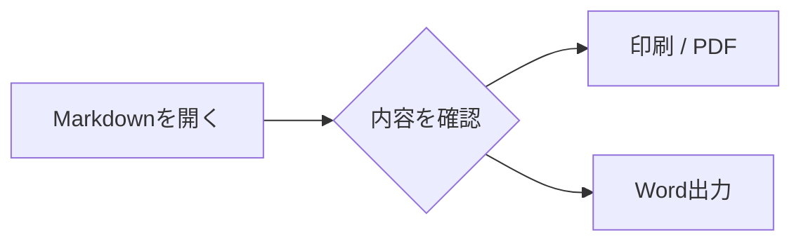
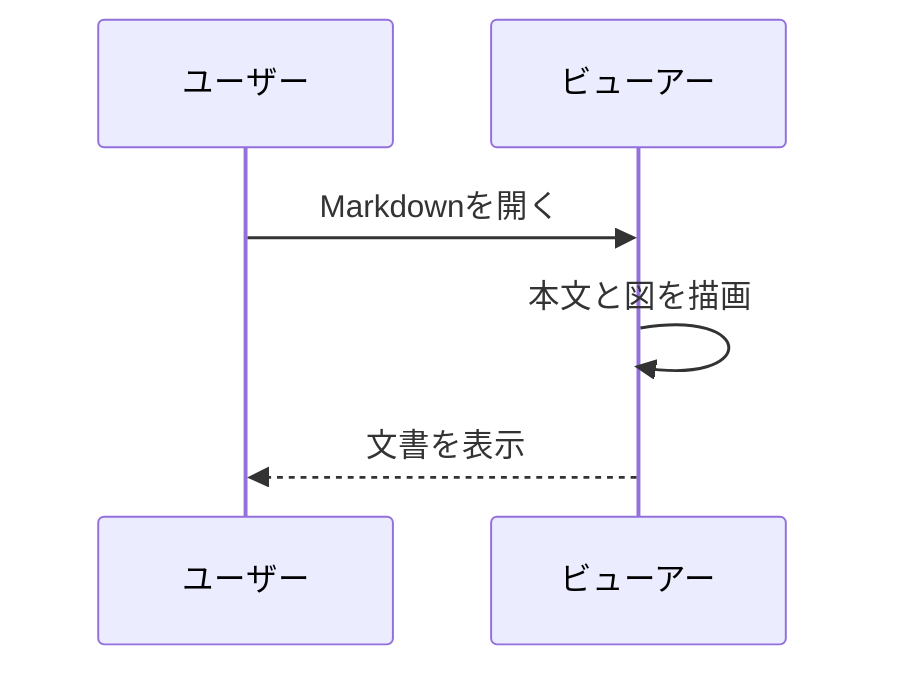
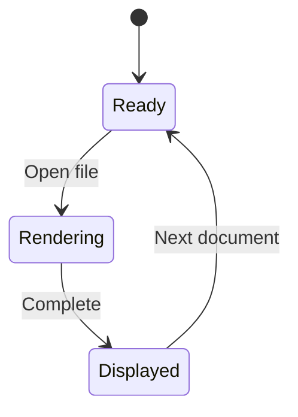
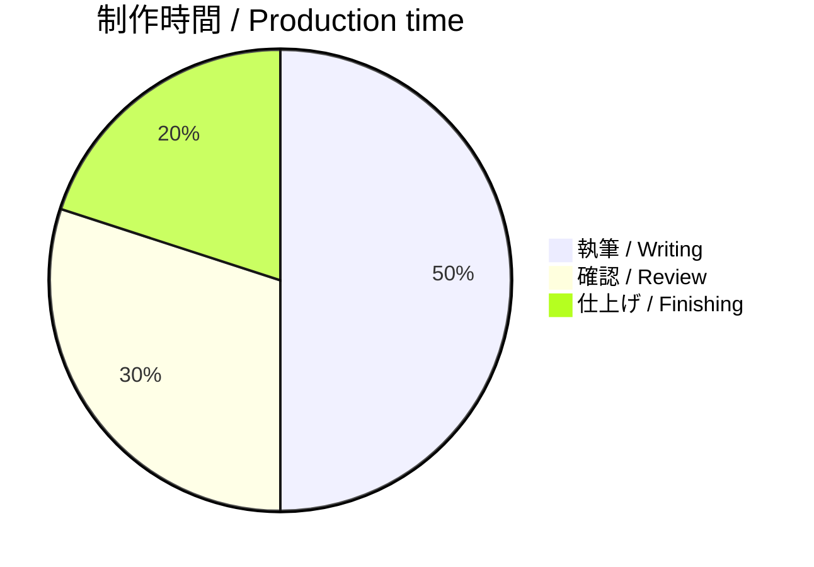
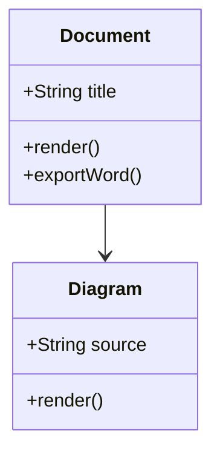
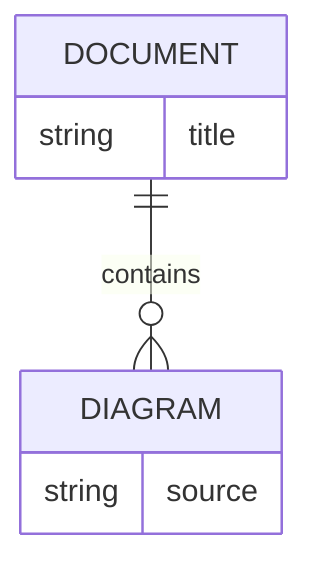

# Mermaid — 図のある文書 / Diagrams in Markdown

コードブロックの言語に `mermaid` を指定すると図を表示します。図は印刷・PDF保存・Word出力にも含まれます。

Use a fenced code block with the language `mermaid`. Diagrams are included in print, PDF, and Word output.

## フローチャート / Flowchart

## シーケンス図 / Sequence diagram

## 状態遷移図 / State diagram

## 円グラフ / Pie chart

## クラス図 / Class diagram

## ER図 / Entity relationship diagram

